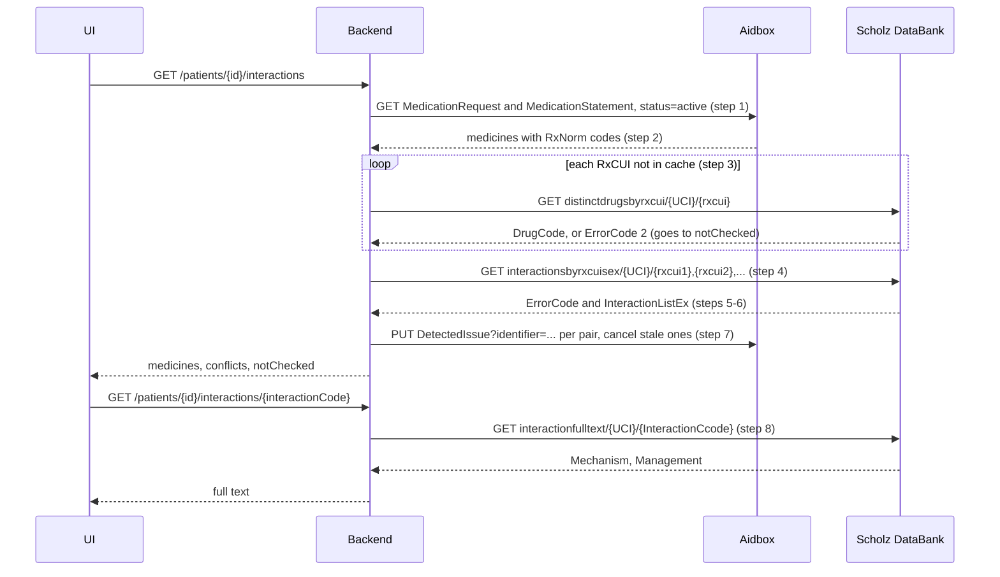

# Drug interaction checks: backend

When the UI ([demo](https://aleksandr-oleinikov.github.io/fhir_camp_2026/)) asks, the service reads the patient's active medicines from Aidbox, sends their RxNorm codes straight to Scholz DataBank and returns the pairs that may not mix well. Three Scholz functions cover it: a lookup per medicine, one interaction check for the whole list, and the full text when the user opens an alert.

## 1. Input

| Call | What it does |
| --- | --- |
| `GET /patients/{id}/interactions` | Checks the patient's current medicines |
| `GET /patients/{id}/interactions/{interactionCode}` | Full text for one interaction, when the user opens the alert |

What has to be in Aidbox: every medicine is an active `MedicationRequest` (prescribed) or `MedicationStatement` (bought by the patient and added in the UI) with an RxNorm code at drug level, for example `314076` "lisinopril 10 MG Oral Tablet". The code sits in `medicationCodeableConcept` or in the `code` of the referenced `Medication`. The mock list in `app/data/patient.js` has names only, so the codes are added when it moves to Aidbox.

Environment variables: `AIDBOX_URL`, `AIDBOX_CLIENT_ID`, `AIDBOX_CLIENT_SECRET`, `SCHOLZ_UCI`.

## 2. Steps

Below, `SDB` = `https://rest.scholzdatabank.com/ditwebservices`. Every Scholz call gets `?format=json`.



1. **Medicines from Aidbox.** `GET {AIDBOX_URL}/fhir/MedicationRequest?subject=Patient/{id}&status=active&_include=MedicationRequest:medication&_count=100` and the same for `MedicationStatement` with `_include=MedicationStatement:medication`. Follow `link` with `relation = next`.
2. **RxCUI.** Take the coding with system `http://www.nlm.nih.gov/research/umls/rxnorm` from `medicationCodeableConcept`, or from the included `Medication.code`. A medicine without an RxNorm coding goes into `notChecked`. The same RxCUI from two resources (prescribed and also bought) is one medicine; keep both resources for `implicated`.
3. **Lookup in Scholz.** `GET {SDB}/distinctdrugsbyrxcui/{UCI}/{rxcui}`. On `ErrorCode = 1`, keep `DrugList[0].DrugCode` (a Scholz code such as `Y23723`) and `DrugName`. On `ErrorCode = 2`, the medicine goes into `notChecked`. This catches RxCUIs Scholz does not know and ingredient-level RxCUIs such as `36567` (simvastatin). The step is required: the interaction check answers an unknown RxCUI with `ErrorCode = 2`, meaning "no interactions", which is a false answer. The lookup takes one RxCUI per call (a list returns `ErrorCode = 8`), so keep a cache by RxCUI.
4. **Check.** If 2 or more medicines passed step 3: `GET {SDB}/interactionsbyrxcuisex/{UCI}/{rxcui1},{rxcui2},...` with all of them. The function name is spelled exactly like this, with the `s`.
5. **Status.** HTTP is always 200; `ResponseStatus.ErrorCode` decides the result: `1` means interactions found, `2` means none, `8` means bad input or no access. On `8` and on a network error the service writes nothing and returns `502` to the UI, not an empty list.
6. **Parsing `InteractionListEx`.**
   * The pair's members are the non-empty `DrugCode1..4`. They are matched to the patient's medicines by the `DrugCode` from step 3.
   * One pair can come back as several rows (different frequency, dose thresholds). Rows are grouped by `InteractionCcode` and the set of `DrugCode`s; the row with the highest `severity` stays.
   * `severity` for the UI: `TrafficLightColor` `red` → 3, `yellow` → 2, any other non-empty color except `green` → 1. The color can be empty; then use `Relevance`: 5 → 3, 4 → 2, 3 → 1. `Relevance` 1 and 2 and the color `green` are not shown.
7. **Writing to Aidbox.** Each pair in `conflicts` is written as a `DetectedIssue` (section 4) with a conditional update: `PUT {AIDBOX_URL}/fhir/DetectedIssue?identifier=urn:fhir-camp-2026:scholz-interaction|{id}-{InteractionCcode}`. A repeat check updates the record instead of creating a duplicate. This patient's `DetectedIssue`s with status `final` that are missing from the new result are set to `cancelled`.
8. **Full text.** `GET {SDB}/interactionfulltext/{UCI}/{InteractionCcode}` is called only from the second route. `InteractionFullTextList[0].Mechanism` and `.Management` come as arrays of strings; `$` in the text is a line break, `$$` a new paragraph.

## 3. Cases

| Case | What Scholz returns | What the backend does |
| --- | --- | --- |
| No interactions | `ErrorCode = 2`, empty list | `conflicts: []`; older `DetectedIssue`s are set to `cancelled` |
| RxCUI unknown to Scholz | Lookup: `ErrorCode = 2`. Check: no error, `ErrorCode = 2`, as if there were no interactions | Caught at step 3, medicine in `notChecked` |
| Ingredient-level RxCUI | Lookup: `ErrorCode = 2`. Check: `ErrorCode = 8`, "Entered RXCUI is not valid" | Caught at step 3, medicine in `notChecked` |
| Medicine without an RxNorm code | Not sent | Medicine in `notChecked` with reason `no RxNorm code` |
| Empty `TrafficLightColor` | `""` | `severity` from `Relevance` |
| Key has no access | `ErrorCode = 8`, "Entered UCI doesn't have privileges" | `502`, reason in the log |
| Network error or timeout | No response | `502`, nothing written to Aidbox |
| More than 30 medicines | URL longer than 324 characters; at 394 characters Scholz returns HTTP 400 | Split the list into chunks of 15 and check every pair of chunks |

## 4. Response for the UI and `DetectedIssue`

Response of the first route:

```json
{
  "patient": "Patient/{id}",
  "medicines": [
    { "rxcui": "314076", "name": "lisinopril 10 MG Oral Tablet", "drugCode": "Y23723", "sources": ["MedicationRequest/{id}"] }
  ],
  "conflicts": [
    {
      "interactionCode": "38010552",
      "severity": 2,
      "medicines": ["314076", "849574"],
      "effect": "blood pressure lowering decreased, crea. a. potass.up, risk of renal failure",
      "whatToDo": "only with careful monitoring; dose adjustment if needed",
      "detectedIssue": "DetectedIssue/{diId}"
    }
  ],
  "notChecked": [{ "source": "MedicationStatement/{id}", "name": "Ibuprofen", "reason": "no RxNorm code" }]
}
```

`severity` matches the UI legend: 3 Serious, 2 Moderate, 1 Minor. `effect` comes from `EffLong`. `whatToDo` comes from `CombiStatusText`, but that field is cut at 50 characters, so take the full wording by the `CombiStatus` code from the dictionary in the Scholz manual's glossary.

`DetectedIssue` fields:

| Field | Value |
| --- | --- |
| `identifier` | system `urn:fhir-camp-2026:scholz-interaction`, value `{id}-{InteractionCcode}` |
| `status` | `final`; `cancelled` when the pair is gone on a repeat check |
| `code` | `http://terminology.hl7.org/CodeSystem/v3-ActCode`, code `DRG`, display `Drug Interaction Alert` |
| `severity` | 3 → `high`, 2 → `moderate`, 1 → `low` |
| `patient` | `Patient/{id}` |
| `identifiedDateTime` | time of the check |
| `implicated` | the `MedicationRequest` and `MedicationStatement` resources of each medicine in the pair |
| `detail` | `EffLong` and `whatToDo` joined with ` \| ` |

## 5. Key and limits

* The UCI (Scholz customer key) goes straight into the URL path. It is read from `SCHOLZ_UCI` and replaced with `***` in logs. This repository is public: never commit the key or Aidbox secrets.
* Scholz calls go over `https` only.
* URL length: 30 RxCUIs (324 characters) pass, 40 RxCUIs (394 characters) return HTTP 400.

## 6. Test requests

| Request | Expected result |
| --- | --- |
| `distinctdrugsbyrxcui/{UCI}/314076` | `ErrorCode = 1`, `DrugCode` `Y23723`, "lisinopril 10 MG Oral Tablet" |
| `distinctdrugsbyrxcui/{UCI}/36567` (ingredient-level simvastatin) | `ErrorCode = 2` |
| `interactionsbyrxcuisex/{UCI}/198211,197853` (simvastatin 40 mg + ketoconazole 200 mg) | 1 pair, `red`, `Relevance` 5, `CombiStatus` 1 (contraindication) |
| `interactionsbyrxcuisex/{UCI}/314076,849574` (lisinopril 10 mg + naproxen sodium 220 mg) | 1 pair, `yellow`, `Relevance` 4, `InteractionCcode` 38010552 |
| `interactionsbyrxcuisex/{UCI}/856987,205532,314076` (hydrocodone/acetaminophen, Pulmozyme, lisinopril) | `ErrorCode = 2`, no interactions |
| `interactionsbyrxcuisex/{UCI}/8888888,310965` (a made-up RxCUI + ibuprofen 200 mg) | `ErrorCode = 2`, no error for the made-up code |

## Sources

* FHIR R4, DetectedIssue: <https://hl7.org/fhir/R4/detectedissue.html>. `status`: "registered | preliminary | final | amended +"; `severity`: "high | moderate | low".
* HL7 Terminology, v3 ActCode: <https://terminology.hl7.org/CodeSystem-v3-ActCode.json>. Code `DRG`: "Drug Interaction Alert".
* FHIR R4, search parameters: <https://hl7.org/fhir/R4/search-parameters.json>. `subject`: "MedicationRequest.subject", "MedicationStatement.subject"; `status`: "MedicationRequest.status | MedicationStatement.status"; `medication`: "(MedicationRequest.medication as Reference)".
* Scholz DataBank, function list: <https://rest.scholzdatabank.com/ditwebservices/default.htm>. "interactionsbyrxcuisex/1234567890/198211,897649", "distinctdrugsbyrxcui/1234567890/198032", "interactionfulltext/1234567890/40010501".
